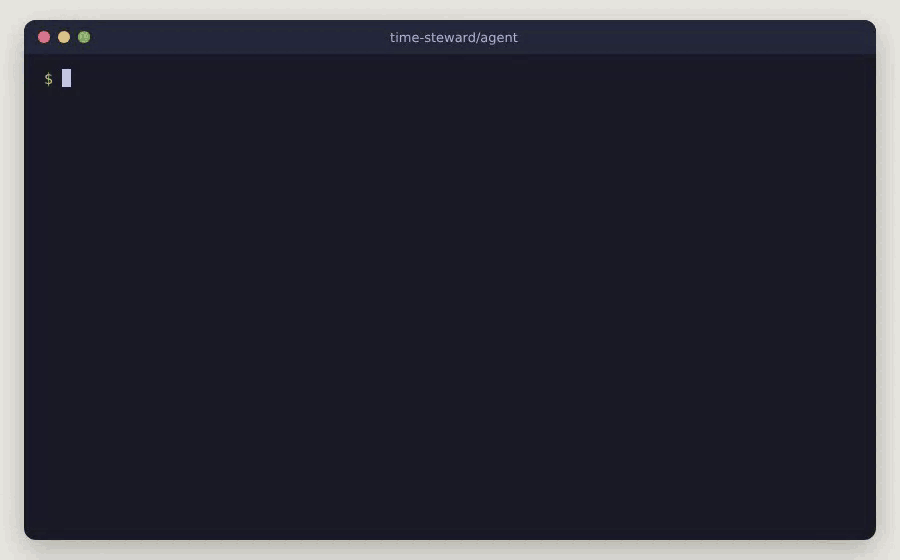
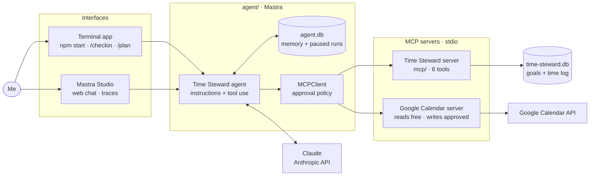
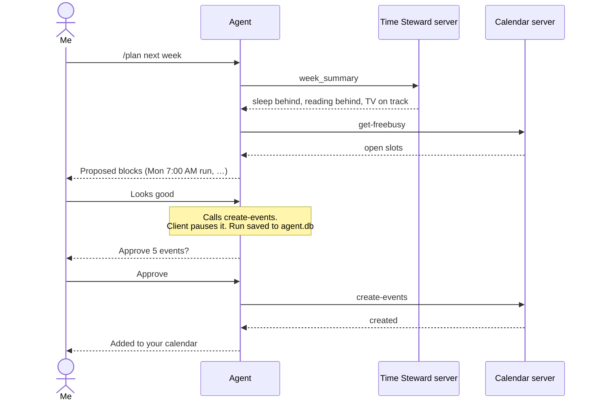
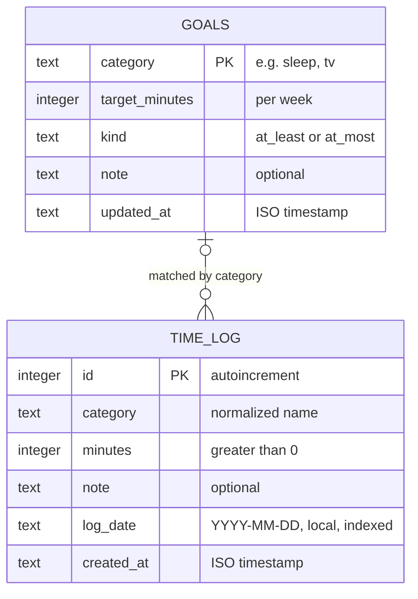

<h1>
  
  Time Steward
</h1>

A personal AI agent that plans my week around what matters to me, then checks in each night on how it actually went.

I set weekly goals (8.5 hours of sleep a night, runs, stretching, non-fiction reading, side-project time, a weekend chore block, and a cap on TV) and tell the agent what I did in plain language: *"ran 30 min, watched 2 hours of TV."* It logs each activity, compares planned against actual time, adjusted for how far into the week I am, and flags where I'm drifting. On Sundays it finds open time on my Google Calendar and proposes blocks to close the gaps. **Nothing is written to my calendar without my approval.**

Built with **TypeScript**, **[Mastra](https://mastra.ai)**, the **Model Context Protocol (MCP)**, **Claude**, and **SQLite**.

<p align="center">
  
</p>

<sub>A nightly check-in, then planning next week with the approval step. Tool calls, data and the approval flow are real; the agent's wording in this recording is scripted.</sub>

## Architecture



| Piece | What it does |
|---|---|
| **`mcp/`**: Time Steward MCP server | My own MCP server. It exposes `set_goals`, `remove_goal`, `log_time`, `list_logs`, `delete_log` and `week_summary` over stdio, backed by SQLite. Any MCP client can use it, including Claude Desktop. |
| **`agent/`**: Mastra agent | Connects to both MCP servers, decides which tools to call, and keeps conversation memory plus durable notes about my routine. |
| **Google Calendar MCP server** | Third-party server ([nspady/google-calendar-mcp](https://github.com/nspady/google-calendar-mcp)). Reading events and free/busy runs freely. Creating, updating or deleting events always pauses for approval. |
| **Interfaces** | A terminal chat with y/n approval prompts, and Mastra Studio for a web chat with Approve/Decline buttons and step-by-step traces. |

### Human in the loop

Calendar writes are gated in the MCP client, not just in the prompt, so the model can't write to my calendar even if it tries. A paused run is saved to storage, so approving it later picks up exactly where it stopped.



## Data model



- **There's no foreign key, on purpose.** An activity without a goal, like an unplanned walk, still gets logged and shows up as *untracked*. Removing a goal keeps its history.
- **Categories are normalized** (`Side Project` becomes `side_project`), so free-text logging always matches the right goal.
- **`log_date` is separate from `created_at`.** Logging last night's sleep this morning still counts toward the right day.
- **`week_summary` stores nothing.** It totals the log for Monday through Sunday and compares it to each goal with pacing: `on_track`, `behind`, `met`, `near_cap` or `over_cap`.

Agent memory and paused approvals are kept separately in `agent.db` and managed by Mastra.

## Getting started

Requires Node 22.13+ and an Anthropic API key.

```bash
# MCP server
cd mcp && npm install && npm run build && npm test

# Agent
cd ../agent && npm install && npm run build
cp .env.example .env        # add ANTHROPIC_API_KEY
npm start                   # terminal chat
npm run playground          # Mastra Studio at http://localhost:4111
```

Google Calendar is optional. See [`agent/README.md`](agent/README.md) for the OAuth setup.

## Testing

- **`mcp/`: `npm test`** starts the server over stdio, the way a real client would, and calls every tool against a temporary database.
- **`agent/`: `npm test`** runs the real agent, MCP server and memory with a scripted mock model, so no API key is needed. It checks that tool calls reach SQLite, that calendar writes pause, that declining blocks the write, and that approving lets it through.

## Repo layout

```
mcp/      Time Steward MCP server (tools, SQLite schema, smoke test)
agent/    Mastra agent, terminal app, Studio entry point, wiring test
```
